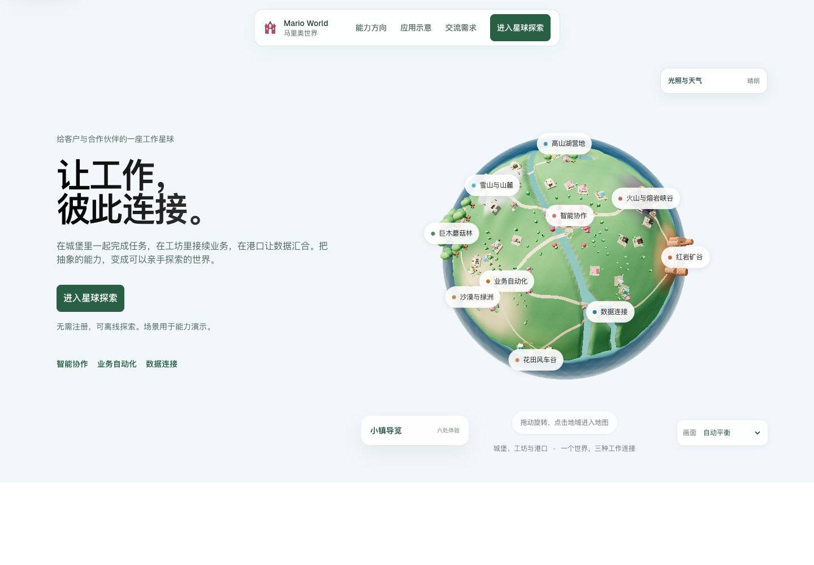

# 马里奥世界 · Mario World

一个可以在线探索的 3D 童话世界。从星球总览出发，进入一片连续的大陆，在城堡、小镇、森林、花田、红岩与湖畔之间漫游。

- [在线首页](https://chatyu12.github.io/mario-world/)
- [星球与大陆探索](https://chatyu12.github.io/mario-world/planet.html)
- [整张大陆](https://chatyu12.github.io/mario-world/planet.html#world)



## 体验

**世界**
- 一片连续大陆，约 204×174 个场景单位，分十个地域：城堡与村落、工坊与道路、港口与水路、雪山、沙漠、火山，以及巨木蘑菇林、花田风车谷、红岩矿谷、高山湖营地。地域之间由十一条路线和六座桥相连。
- 星球和大陆共用同一套地理、高度场、海岸线、道路和聚落位置，从星球降落到大陆时，位置是连续的。
- 大陆使用固定的等距正交视角（45° / 35.264°），可以从整岛连续缩放到单栋建筑（zoom 1–12）。右下角的「旋转视角」按钮或快捷键 `R` 会把大陆翻转 180°，用来看背面。

**生活感**
- 小镇有石板主街、排屋、摊位和带水池的圆形广场。约 47 名居民沿安全路径行走，会互相让行，起步、停下和转身都有过渡。
- 点击居民，镜头会推近并跟随他走动。关闭面板或拖动画面，会回到分区视角。
- 小镇的设备会运转：风车、水车、按真实时间走的钟楼、铁匠铺的锤子、喷泉、码头吊臂、屋顶炊烟。
- 地标层包括入口牌坊、樱花林和飘落的花瓣、栈道观景台、叠水、路灯、路牌，以及红岩矿谷的矿车轨道。
- 地面细节：草甸、土壤、坡度岩土和海岸湿沙都由程序化着色生成，另有实例化的草丛、野花、碎石、芦苇和建筑接地阴影。

**天气与光照**
- 时间和天气连续过渡，日照、薄暮、月光、雾、云层和海面反射同步变化。
- 雨和雪固定在世界坐标里，会被真实的地形、屋顶、桥面和树冠遮挡。地面上的水圈、湿润效果和渐进积雪，来自一张 256 格的静态高度场近似。
- 天气是离线模拟的，不读取定位，也不读取实况。

**性能**
- 几何预算：最多 700,000 个三角形，两个视图的几何缓冲合计不超过 64 MiB。上次实测为 497,560 个三角形、40,161,092 字节。
- 桌面端绘制上限为每秒 60 次，手机端初始上限为每秒 30 次。自动档下，移动时会降低分辨率，停下后恢复完整细节；画面静止时不做额外绘制。另外支持减少动态效果、兼容模式和 WebGL 上下文恢复。
- 页面不再等 3D 场景加载完才能用：约 2.5 MB 的场景脚本由 `assets/world-loader.js` 在后台并行下载，菜单、表单和文字马上就能操作。

**页面**
- 首页包括浮动导航、能力介绍、应用示意、FAQ，以及可以直接交互的星球。六个虚构的业务演示，可以通过建筑和居民进入。
- 业务、表单和居民互动都是虚构演示：不发送请求，不连接真实服务，不写浏览器存储。

## 项目结构

```
index.html          首页（含交互星球）
planet.html         全屏星球与大陆探索
404.html            GitHub Pages 的 404 页
assets/
  base.css          两个页面共用的样式
  home-design.css   首页专用样式
  island-ui.css     探索页大陆视图的专用样式
  world-loader.js   3D 世界模块清单与后台加载器（唯一列出场景脚本的地方）
  site.js           页面交互入口：等世界加载完后启动场景，管理地图、面板和表单
  planet3d.js       星球 / 大陆双尺度相机、拾取、标签
  connected-map.js  大陆地形、道路与桥梁
  world-*.js / village-life.js / frontier-scenes.js / town-facilities.js /
  island-landmarks.js / ground-scatter.js / map-weather.js
                    场景各层：模型、地理、环境、居民、设施、地标、地被、降水
  town-ui.js / environment-ui.js / demo-businesses.js / nodes.js
                    小镇面板、天气面板、虚构业务和能力数据
  imported-models.js, models/   KayKit 模型数据与来源说明
  three.min.js      Three.js r147
tools/
  bump-version.sh   更新所有静态资源的缓存版本号
```

模块都是普通脚本，通过 `window.Mario*` 全局对象互相引用，不需要构建。

## 运行与部署

这是纯静态站点，不需要构建，也不依赖 CDN。

```sh
python3 -m http.server 8080
```

然后打开 `http://localhost:8080/`。也可以直接双击打开 HTML 文件。

GitHub Pages 从 `main` 分支的根目录发布，推送后会自动更新。发布前运行一次：

```sh
tools/bump-version.sh          # 默认用当天日期作为版本号
```

它会更新三个页面里所有 `?v=` 参数，场景模块会继承加载器的版本号，所以浏览器不会继续用旧缓存。

浏览器验收用的是 Chrome 和移动端视口模拟，还没有在真机或 Safari 上测试，也不承诺固定帧率。

## 第三方资源

Three.js r147 使用 MIT 许可；KayKit Medieval Hexagon Pack 1.0 使用 CC0 许可；Press Start 2P 和 Geist 使用 SIL OFL 许可。原始许可、固定来源和模型修改说明见 [第三方资源说明](THIRD-PARTY-ASSETS.md)。补充的模型和细节由本项目自行生成。

本项目用于主题演示，不代表任天堂官方产品，也与任天堂没有合作关系。
